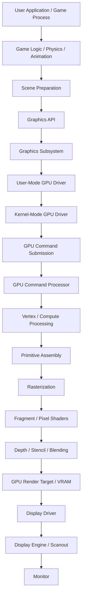

# Operating System Graphics Architecture

## 1. Graphics Pipeline Architecture

The graphics subsystem is responsible for providing a hardware-independent graphics interface to applications while managing rendering resources, GPU execution, and display output.

The architecture separates application logic, graphics command generation, GPU execution, and display management.

### Architecture Layers

| Layer | Component | Responsibility |
|---|---|---|
| 1 | User Process | Runs the application, game logic, physics, animations, and scene management. |
| 2 | Graphics API | Provides graphics operations such as draw calls, buffer creation, texture management, and shader submission. |
| 3 | Graphics Subsystem | Manages graphics resources, command submission, synchronization, memory allocation, and device selection. |
| 4 | User-Mode GPU Driver (UMD) | Translates graphics API operations into GPU-specific commands, compiles shaders, and prepares command buffers. |
| 5 | Kernel-Mode GPU Driver (KMD) | Manages GPU memory, command submission, hardware scheduling, interrupts, and GPU access permissions. |
| 6 | GPU Command Processor | Fetches and executes command buffers submitted by the CPU through the GPU driver. |
| 7 | GPU Execution Units | Execute vertex, geometry, compute, and fragment/pixel shader workloads. |
| 8 | GPU Memory / VRAM | Stores textures, vertex buffers, index buffers, depth buffers, and render targets. |
| 9 | Display Driver / Display Engine | Configures display modes, scanout, output timing, and presentation. |
| 10 | Display Device | Physical monitor or virtual display device. |

### CPU and GPU Responsibilities

**CPU responsibilities:**
- Game/application logic.
- Physics and collision detection.
- Animation and skeletal calculations.
- Scene graph and visibility management.
- Preparing vertex and index data.
- Generating graphics commands.
- Uploading resources to GPU memory.
- Submitting command buffers.

**GPU responsibilities:**
- Executing submitted GPU commands.
- Vertex processing.
- Triangle assembly and rasterization.
- Fragment/pixel shading.
- Depth and stencil testing.
- Texture sampling.
- Writing rendered pixels into render targets.

The GPU does not independently determine what the game world looks like. The CPU prepares the scene and rendering instructions; the GPU executes them.

---

## 2. Rendering Pipeline — Mermaid Diagram



---

## 3. How GPU Drivers Actually Work

A GPU driver is not simply a function that tells the GPU to draw something.

Modern GPU architectures use command buffers and hardware execution queues.

The application generally does not communicate directly with GPU hardware. Instead, graphics API calls are translated into hardware-specific commands by the user-mode driver.

### 3.1 User-Mode Driver (UMD)

The user-mode driver is responsible for translating API operations into commands that a specific GPU understands.

For example:

1. The application requests a triangle to be rendered.
2. The graphics API receives the draw operation.
3. The UMD prepares the necessary GPU state.
4. Shaders are compiled or retrieved from cache.
5. Vertex and index buffers are prepared.
6. GPU commands are written into a command buffer.

The result is a GPU-specific command buffer ready for submission.

### 3.2 Kernel-Mode Driver (KMD)

The kernel-mode driver manages access to the physical GPU.

Its responsibilities include:

- GPU memory allocation and mapping.
- Command buffer validation and submission.
- GPU scheduling and execution synchronization.
- Hardware queue management.
- GPU interrupts and completion notifications.
- Device initialization and reset handling.
- Security and process isolation.

The KMD submits command buffers to the GPU through hardware-specific mechanisms such as MMIO registers, DMA-backed queues, and doorbell registers.

The exact mechanism depends on the GPU architecture.

### 3.3 GPU Command Execution

Once the command buffer is submitted:

1. The GPU command processor fetches commands.
2. It interprets the command stream.
3. Vertex data is processed.
4. Triangles are assembled.
5. Rasterization generates fragments.
6. Pixel shaders execute.
7. Depth testing and blending are performed.
8. The final pixels are written into a GPU render target.

The GPU performs these operations independently after submission. The CPU does not need to issue a separate instruction for every pixel.

---

## 4. Per-Frame Rendering Lifecycle

A typical game rendering loop looks like this:

```text
FRAME START
    |
    v
CPU: Update Game State
    |
    v
CPU: Physics / Animation / Input
    |
    v
CPU: Prepare Scene
    |
    v
CPU: Generate Draw Commands
    |
    v
UMD: Compile / Translate / Build Command Buffer
    |
    v
KMD: Validate and Submit Commands
    |
    v
GPU: Execute Command Buffer
    |
    v
GPU: Render into Framebuffer / Render Target
    |
    v
GPU: Signal Completion / Fence
    |
    v
Display: Present Completed Frame
    |
    v
FRAME END
```

This process repeats for every frame.

For example, at 60 FPS, a new frame is produced approximately every 16.67 milliseconds.

**Important:** CPU and GPU execution are normally asynchronous. The CPU can prepare frame N+1 while the GPU is still rendering frame N. Multiple command buffers and frames in flight are commonly used to keep the hardware busy.

A synchronization primitive such as a fence ensures that the display does not present a render target before GPU rendering has completed.

---

## 5. Render Target vs Display Output

These are two different operations.

**Rendering:**

The GPU writes the completed image into a render target, usually located in VRAM or accessible GPU memory.

**Presentation:**

The display engine reads the completed image through scanout and sends the pixel stream to the monitor.

The operating system's compositor may also combine multiple application surfaces before the final image is presented.

The GPU does not normally send its completed framebuffer back to a separate CPU renderer. The display engine consumes the GPU-rendered image directly.

---

## 6. Software Rendering Fallback

A hardware-independent graphics API should also support a software rendering backend.

```text
Graphics API
     |
     v
Graphics Subsystem
     |
     +----------------------+
     |                      |
     v                      v
Software Renderer       Hardware Renderer
     |                      |
     v                      v
CPU Rasterization       GPU Driver
     |                      |
     v                      v
System Framebuffer      GPU Render Target
     |                      |
     +-----------+----------+
                 |
                 v
           Display Output
```

In software rendering mode, the CPU performs rasterization, shading, depth testing, and pixel generation.

The resulting framebuffer is then presented through the available display driver.

This allows the operating system to provide graphics functionality even when no supported GPU is available.

---

## 7. Recommended OS Implementation Strategy

Implement the graphics architecture in independent components:

| Component | Implementation Priority |
|---|---|
| Framebuffer Driver | First |
| Display Management | First |
| Software Rasterizer | Second |
| Graphics API | Second |
| Graphics Resource Manager | Second |
| GPU Driver Interface | Third |
| VirtIO-GPU Driver | Third |
| Hardware GPU Drivers | Later |
| Compositor / Window Manager | Later |

The graphics API should not depend directly on a specific GPU.

Instead, define a backend interface that supports multiple rendering implementations:

- Software Renderer
- VirtIO-GPU Renderer
- Hardware GPU Renderer

The kernel should own hardware access, memory management, synchronization, and driver infrastructure. Complex rendering logic can remain in user space.

**Final architectural principle:** The CPU prepares the scene and GPU command stream. The GPU executes those commands and writes the rendered image. The display engine presents that image. These are separate responsibilities and should remain separate in the operating system architecture.